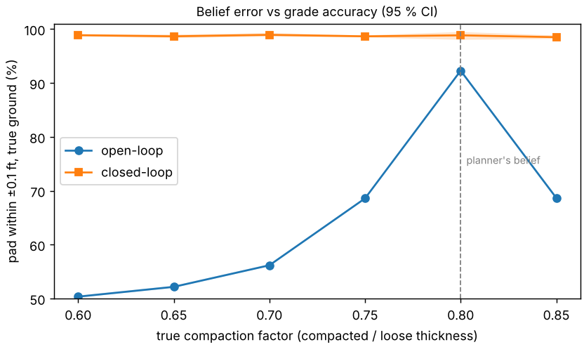

# Loam

**An open language for programmable, closed-loop earthmoving.**

Loam is to a job site roughly what G-code is to a CNC machine, with one difference that drives the whole
design: soil is not a rigid workpiece. A Loam program states the finished ground, the machines, the
sensors and the safety rules, and says *when the work is done* in terms of **measured** ground. A runtime
turns it into passes for each machine and keeps checking the real ground, for example from a tethered
drone, until the site is in tolerance.

```loam
loam 0.0.1

site pad_north {
  crs    "EPSG:6447"
  units  ft
  design "pad_design.xml" format landxml surface "FG"
}

probe overhead { kind tethered_uav; sensor lidar; rate 5 min; accuracy 0.05 ft }
machine dz1    { class dozer; blade 12 ft }

zone A { role cut;  area rect (0, 0) (85, 100);   tolerance ±0.1 ft }
zone C { role fill; area rect (85, 0) (160, 100); lift 8 in }

task strip_A {
  op      cut
  zone    A
  by      class dozer
  max_cut 0.5 ft per pass
  spoil   -> C
  until   residual(A).high < 0.15 ft
}

rule people { when proximity(person, machine) < 50 ft; do stop all }
replan drift { when deviation() > 0.15 ft }
```

| Document | Contents |
| --- | --- |
| [SPEC.md](SPEC.md) | Language, execution semantics, Loam Wire messages, safety model |
| [docs/RUNTIME.md](docs/RUNTIME.md) | Running a site: plan, controller, simulated site, secured broker, monitor; what the system tests showed |
| [docs/FIELD.md](docs/FIELD.md) | Field equipment: grade control, RTK, lidar, cameras; coordinates; what cannot be connected |
| [docs/INTEGRATIONS.md](docs/INTEGRATIONS.md) | Every integration, its licence and what it was tested against; what was left out and why |
| [docs/SIMULATOR.md](docs/SIMULATOR.md) | Reference simulator: model, equations, invariants, limitations |
| [results/study.md](results/study.md) | Monte Carlo study, 420 seeded runs |
| [schemas/wire](schemas/wire) | JSON Schema for Loam Wire (controller ↔ machines ↔ probes over MQTT) |
| [CHANGELOG.md](CHANGELOG.md) | What changed in each release |

## Quick start

```bash
pip install -e ".[plot]"                 # Python ≥ 3.10; numpy (matplotlib only for plots)

loam check   examples/pad_north.loam      # parse + units, references, cycles, capabilities
loam explain examples/pad_north.loam      # the program in plain English
loam compile examples/pad_north.loam -o plan.json    # execution manifest and MQTT topics
loam sim     examples/pad_north.loam --wire messages.jsonl --plot result.png
loam sim     examples/pad_north.loam --open-loop     # same program, one survey, no feedback
```

## What the simulation shows

`examples/study.py` runs the example program with 50 seeds per mode. The simulated soil swells and
compacts differently than the planner initially assumes (net 0.91 vs 1.00 bank-to-fill), and blades
cut with 6 % random error. The table gives means with 95 % bootstrap confidence intervals:

| Pad cells within ±0.1 ft | Open loop (one survey) | Closed loop (survey every 5 min) |
| --- | --- | --- |
| On the true ground | 60.8 % [60.7, 60.9] | 98.5 % [98.4, 98.6] |
| As the program believed | 95.5 % [95.4, 95.6] | 97.4 % [97.2, 97.5] |

The open-loop run reports success while 39 % of the pad is out of tolerance. The closed loop stops as soon
as the program's own completion rule holds on measured ground (95 % of cells in tolerance), so its
true-ground figure sits a little above that line rather than at 100 %. A 2×2 factorial separates
the causes. Belief error accounts for most of the gap (open loop 92.2 % → 60.8 %); execution noise
accounts for the rest. With correct beliefs and noiseless blades, open loop is unbiased and meets its
completion rule. That control is checked in the test suite, so the gap cannot be an artefact of the
simulator favouring feedback.



These are results of a simplified model with assumed soil factors, not field measurements; see
[docs/SIMULATOR.md](docs/SIMULATOR.md) for every assumption and limitation.

## Commands

| Command | What it does |
| --- | --- |
| `loam check`, `explain`, `compile` | Check a program; describe it in plain English; write its execution manifest |
| `loam sim` | The reference simulator, in one process (closed or open loop) |
| `loam plan` | Write a site program from a grading LandXML (existing and design surfaces) |
| `loam level` | Design a levelled field from its ground alone (a free elevation model and a boundary traced in Google Earth), and write its program |
| `loam run` | The site controller: orders, replans and safety rules over MQTT |
| `loam simulate-site` | A simulated site to run the controller against: world, lidar probe, one process per machine, scripted faults |
| `loam monitor` | Live web dashboard, Prometheus metrics, replay pages, MCAP recording |
| `loam mavlink`, `vda5050`, `nav2`, `opera` | Drive a real vehicle as a Loam machine: ArduPilot Rover (with its blade, if nobody is aboard), VDA 5050 robots, any ROS 2 vehicle on Nav2, OPERA machines |
| `loam conform` | Check that a machine keeps its side of Loam Wire, whoever built it |
| `loam nmea` | Publish an RTK receiver's position as a machine's state |
| `loam terrain` | Grid a lidar scan onto the site; publish scans as they are written (`--watch`), with the person-sized things in them (`--objects`) |
| `loam sense` | People from Frigate cameras, from their phones and trackers, and the two matched; rain from an rtl_433 gauge |
| `loam wifi-fit` | Measure a site's Wi-Fi signal model from a walk, for locating phones |
| `loam estop`, `resume` | Press or release the site e-stop; restart machines after a stop |
| `loam broker` | Write a secured Mosquitto setup for the site, with its install script |
| `loam export`, `score` | Next-pass surfaces and field files for grade control; score a survey against the design |
| `loam soil-calibrate` | Roller compaction curves from Project Chrono's soil model |

## From a grading file to a running site

`loam plan` turns the LandXML a project manager receives (existing and finished-grade surfaces) into a
checked site program. `loam run` is the site controller: it sends Loam Wire orders over MQTT, reads
terrain and machine state, replans, and enforces the safety rules. `loam simulate-site` starts a world,
a lidar probe and one process per machine to test it against, with scripted faults, and
`loam monitor` is a live web dashboard. See [docs/RUNTIME.md](docs/RUNTIME.md).

```bash
pip install -e ".[run]"   &&   mosquitto -p 1883 &
loam plan job.xml -o job.loam
loam simulate-site job.loam --speed 60 &
loam monitor job.loam --port 8080 &        # http://127.0.0.1:8080/
loam run job.loam
```

In end-to-end runs on real design surfaces, with a person near a machine, a lidar outage, rain, GNSS
float, a lost radio, a site e-stop and a crashed dozer, every fault was handled and the jobs finished
with 95.8–97.6 % of cells in tolerance on the simulated true ground.

## On a real site

The same controller runs real machines. What a first field test needs, in the order it is set up:

```bash
# 1. The broker: encrypted, a name and password per client, each machine limited to its own topics
loam broker job.loam --host site-server --address 192.168.1.10 && sudo sh broker/install.sh

# 2. Positions and vehicles (each on its machine's computer, with its own password file)
loam mavlink job.loam --machine dz1 --vehicle udp:127.0.0.1:14550 --broker mqtts://dz1@site-server

# 3. Ground, people, rain
loam terrain job.loam scans/ --watch --ground-filter --objects --broker mqtts://sensors@site-server
loam sense   job.loam --areas cameras.json --tags people.json --rain --origin LAT,LON \
             --broker mqtts://sensors@site-server

# 4. The controller, the dashboard with a recording of every message, and the e-stop
loam run     job.loam --real-time --broker mqtts://controller@site-server
loam monitor job.loam --mcap run.mcap            --broker mqtts://supervisor@site-server
loam estop   job.loam                            --broker mqtts://supervisor@site-server
```

- **Any machine that is open can be driven.** ArduPilot, ROS 2 with Nav2, VDA 5050, or Loam Wire spoken
  directly. `loam conform` checks a machine before it is trusted. For a machine with nobody aboard,
  `loam mavlink --blade-servo` also holds the blade to the next-pass surface. See "Connecting a machine" in
  [docs/FIELD.md](docs/FIELD.md), which also lists which machines on the market are open and which are not.
- **Machines protect themselves.** `loam mavlink` uploads the site boundary and exclusion zones to the vehicle
  as fences and switches on its failsafe, so it holds if Loam or the radio dies. `loam opera` reports stops by
  Nav2's Collision Monitor and carries on when the way is clear.
- **What cannot be seen is unsafe.** A blind camera, a silent camera system or a stopped sensor program counts
  as a person there. A machine whose clock is more than 2 s off gets no orders. Stale survey data holds
  every machine.
- **People are found two ways and the two are compared.** Phones (OwnTracks, Wi-Fi signal, Meshtastic) say who
  is on the site and roughly where; cameras calibrated to the ground and lidar scans say exactly where someone
  stands. Where everyone on foot is tagged, a phone's wide circle becomes the place the person is seen, and a
  phone heard where nobody is seen stops the machines. Wi-Fi alone places nobody: its circle is about 170 m
  across a site. See "People on foot" in [docs/FIELD.md](docs/FIELD.md).
- **Nothing depends on one message.** A machine announces itself again after every reconnect, sensors repeat
  what they see, and the e-stop is retained, so a dropped radio link or a restarted broker heals by itself.

Loam works with the equipment through files and simple streams, with no vendor SDKs: LandXML next-pass
surfaces for **Cat Grade with 3D** (and Trimble, Topcon, Leica), `.agd` design grids for **OpenGrade3D**,
field folders for **AgOpenGPS**, survey points from **Emlid Reach**, **QField** and **QGIS**, NMEA from any
RTK receiver, and LAS/PCD scans from a **DJI Zenmuse L2** or **Livox Mid-360**. See
[docs/FIELD.md](docs/FIELD.md) for the commands, the coordinate setup and what cannot be connected
(Cat Command, closed retrofit kits).

```bash
loam terrain site.loam scan.las --world-origin 600000,3812000          # grid a lidar scan
loam export  site.loam --to landxml -o next.xml --ground scan.las --world-origin 600000,3812000
loam score   site.loam rover.csv --zone pad --world-origin 600000,3812000
```

## Tested as a whole system

`tools/site_soak.py` runs a complete job on the example site the way a real one runs: a broker, the
controller, the dashboard and one process per machine, with a person near a machine, a lidar outage, rain,
GNSS float, a lost radio and an e-stop along the way. It samples every process and validates every recorded
message. The run for v0.0.8, 35 minutes at 6× real time:

| Checked | Result |
| --- | --- |
| The job | finished in 209 site minutes with 6 replans; 97.4 % of the pad within ±0.1 ft on the true ground; soil factors learned as 1.300 and 0.708 (true: 1.3 and 0.7) |
| Errors | none logged by any of the nine processes; all exited cleanly; none left running |
| Messages | 24,819 recorded, all valid against the Wire schema |
| Memory | no leak found: Python-level allocations flat in every process; controller level at 48 MB after 10 minutes; each machine process 40.3 to 40.9 MB over the run, still creeping by 2 to 6 kB a minute at the end |
| Message transport | 490,120 messages (27 machine-hours of state) in 150 s: all delivered, memory flat |
| Broker restarted mid-job | every process reconnected; job finished, 98.5 % in tolerance |
| Controller killed mid-job | restarted 8 s later and finished the job, 97.8 % in tolerance |

The first run of this test, on v0.0.7, was not that clean. It found that a machine stayed written off after any
reconnect, that a restarted controller reused its order ids, that one lost message could hold the site for good,
that late surveys upset the soil estimates, and that the published schema did not match the messages. All are
fixed in v0.0.8;
[docs/RUNTIME.md](docs/RUNTIME.md) has the details, and [CHANGELOG.md](CHANGELOG.md) the list.

## Integrations

Every integration is an optional, FOSS extra (`pip install "loam-lang[all]"`); the core needs numpy only.
[docs/INTEGRATIONS.md](docs/INTEGRATIONS.md) lists each one with its licence and what it was tested against.

- **Vehicles:** ArduPilot Rover and other MAVLink ground vehicles (`loam mavlink`), VDA 5050 3.0 robots
  (`loam vda5050`), and PWRI's OPERA machines on ROS 2 (`loam opera`: IC120 carriers through Nav2, the ZX200's
  arm cutting to grade). Tested against ArduPilot SITL, the official VDA 5050 schemas, Nav2 and ros2_control.
- **Site sensors:** people from Frigate's cameras and rain from an rtl_433 gauge (`loam sense`); lidar scans as
  they are written (`loam terrain --watch`).
- **Broker:** Mosquitto with TLS, set up by `loam broker`; tested in CI on Ubuntu's packaged, AppArmor-confined
  service.
- **Positioning:** `loam nmea tcp://…` reads RTKLIB, RTKBase or a receiver directly; chrony and gpsd keep the
  site's clocks together.
- **Survey data:** OpenDroneMap project folders, LAZ with a ground filter that removes machines, people
  and brush (checked against PDAL's SMRF), GeoTIFF DEMs, QField and QGIS survey points, and real CRSs
  through pyproj.
- **Design data:** IFC 4.3 surfaces through IfcOpenShell; GeoTIFF surfaces; GeoJSON areas from QGIS;
  `export --to geotiff | geojson`.
- **Soil physics:** `loam soil-calibrate` derives roller compaction per pass from Project Chrono's SCM
  soil model; `simulate-site --soil-table` uses it.
- **Operations:** Prometheus `/metrics` for Grafana, and every Wire message recorded to MCAP for Lichtblick
  or PlotJuggler (`loam monitor --mcap`).

## Repository layout

| Path | Purpose |
| --- | --- |
| `loam/lexer.py`, `loam/parser.py` | Tokenizer and recursive-descent parser; errors carry line:column |
| `loam/checker.py` | Units and dimensions, references, dependency cycles, capability coverage |
| `loam/evaluate.py` | Evaluates `when` / `until` conditions against a site context (SI units) |
| `loam/compiler.py` | JSON manifest and plain-English explanation |
| `loam/landxml.py` | LandXML TIN reader/writer and rasterizer |
| `loam/sim.py` | Closed-loop reference simulator with a volume ledger |
| `loam/rng.py` | Specified counter-based RNG, reproducible in any language |
| `loam/wire.py` | Loam Wire message builders |
| `loam/grid.py`, `loam/geo.py` | The site height grid; placing it on WGS84 and projected coordinates |
| `loam/pointcloud.py` | Streaming LAS/LAZ and PCD readers (DJI L2, Livox Mid-360), gridding, ground filter |
| `loam/surfaces.py` | IFC 4.3 and GeoTIFF surfaces; GeoJSON, KML and shapefile areas; GeoTIFF and GeoJSON export |
| `loam/survey.py` | Emlid/RTK survey CSV, NMEA GGA to Wire state, scoring against design |
| `loam/plan.py` | `loam plan`: grading LandXML to a site program |
| `loam/level.py` | `loam level`: a levelling design (best-fit plane, slope limits, cut/fill balance) from the ground alone |
| `loam/runtime/` | Controller over MQTT, simulated world, machines (optionally PyBullet physics) and probe |
| `loam/runtime/bridge.py`, `mavlink.py`, `vda5050.py`, `opera.py` | Real vehicles as Loam machines: one safety loop, three protocols |
| `loam/runtime/blade.py` | A blade held to the next-pass surface by the bridge, for a machine with nobody aboard |
| `loam/conform.py` | `loam conform`: the eight checks a machine must pass to be driven by Loam |
| `loam/sensors.py` | `loam sense`: people from Frigate (placed on the ground by calibrated cameras), rain from rtl_433, as Wire messages |
| `loam/tags.py` | People located by phone, Wi-Fi and tracker; matching them with what lidar and cameras see; the Wi-Fi model learnt on site |
| `loam/wirelog.py` | MCAP recorder for Wire messages |
| `loam/broker.py` | `loam broker`: certificates, passwords, access rules and install script for the site's Mosquitto |
| `loam/runtime/chrono_soil.py` | Roller compaction curves from Project Chrono's SCM soil model |
| `tools/integration-envs.sh` | Conda environments for Chrono, ROS 2 (OPERA) and PDAL, for the integration tests |
| `tools/site_soak.py` | Runs a whole simulated site and reports each process's memory, files and threads; can restart the broker or the controller mid-job |
| `loam/monitor.py`, `loam/monitor.html` | Live dashboard and replay pages |
| `loam/target.py`, `loam/export.py` | Next-pass surface; LandXML (Cat Grade 3D), OpenGrade3D `.agd`, AgOpenGPS field folder |
| `examples/` | Example program and surfaces, comparison plot, Monte Carlo study |
| `tests/` | 258 tests: language, I/O, simulator invariants, field adapters, planner, field levelling from rasters and boundary files, controller loopback, a full multi-process MQTT run with faults in which every message is validated against the schema, reconnects and restarts, vehicle bridges (ArduPilot SITL and a fake ArduPilot, VDA 5050, RTKLIB, OPERA on Nav2 and ros2_control, ArduPilot fences and failsafe, Nav2's Collision Monitor), e-stop and SIGTERM safety, a TLS broker with access rules (also on a system-installed Mosquitto), site sensors (a stand-in Frigate, rtl_433 on recorded gauges), people located by phone and matched with cameras and scans (3,000 random sites), a blade held by the bridge and the conformance check (both against a fake ArduPilot), Chrono soil, integrations (PDAL cross-check included), parser fuzzing; every test also fails on a leaked thread, process or file |

## Development

```bash
pip install -e ".[dev]"
pytest -q --cov=loam          # 258 tests, about 8 min; the MQTT tests need mosquitto
python tools/site_soak.py out/ --speed 60     # a whole simulated site, watched; about 4 min
ruff check loam tests examples
mypy loam
python examples/study.py      # about 1 min on 2 cores; rewrites results/
```

CI runs the tests on Python 3.10 to 3.13, sets up the secured broker on Ubuntu's packaged Mosquitto and
tests against it, and runs lint, type checks and a reproducibility check of the example surfaces. Contributions: see [CONTRIBUTING.md](CONTRIBUTING.md).

## Status and safety

v0.0.9 is an early draft; the language and wire format will change. Releases are pre-releases on
[GitHub](https://github.com/shawnbreaux/loam/releases); [CHANGELOG.md](CHANGELOG.md) says what each one changed. **Loam does not make a
machine safe.** Machines directed by Loam need their own certified safety systems and a site risk
assessment (ISO 17757). The reference simulator is a test tool, not a planner for real equipment.

## License

Code: [Apache 2.0](LICENSE), which includes an explicit patent grant. Specification: [CC BY 4.0](LICENSE-SPEC).
If you use Loam in research, please cite it (see [CITATION.cff](CITATION.cff)).
